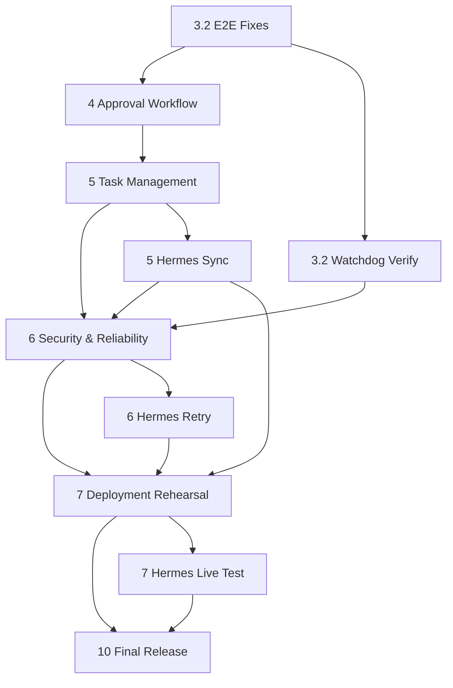

# Bangron Virtual Office — Accelerated Project Completion Roadmap

**Project:** Bangron Virtual Office
**Repository:** https://github.com/herdianrony/bangron-virtual-office
**Working Branch:** `fix/security-hardening`
**Target:** 10 working days (Mon 2026-11-20 → Fri 2026-12-04)
**Current HEAD:** `5a23e358cf7ae936d9f87fa45af130607fa1fe9c` (docs: PR numbering alignment; tested code SHA for Phase 3.2.2 evidence: `22d66b6`)
**Current PR:** #1 — Security hardening and top-down visual foundation (DRAFT, OPEN — ready for Director review; merge awaits explicit approval). PR #2 (GitHub Actions CI, head `5d56112`) is stacked on PR #1; both unmerged; `main` at `82fc1f6`.

> **PR numbering (finalized 2026-11-20):** PR #1 = security hardening & Phase 3.2; PR #2 = GitHub Actions CI (`chore/github-actions-ci`, stacked on PR #1); PR #3 = Phase 4 (planned); Phase 5 → PR #4, Phase 6 → PR #5, Phase 7 → PR #6. Task references below use this numbering.

---

## Executive Summary

| Metric | Status |
|--------|--------|
| Unit & Integration Tests | **98 passed / 0 failed / 0 skipped** (13 files) — verified at `22d66b6`, re-verified by CI at `5d56112` (original target of 48 superseded) |
| E2E Tests (Playwright) | **10 passed / 0 failed / 0 skipped** (5 Phase 3.1 smoke + 5 Phase 3.2 lifecycle, chromium) — auth/session issues fixed in Phase 3.2.2 (original target of 13 superseded) |
| CSS Build | **Successful** (`npm run build:css`, tailwindcss v4.3.5) |
| Hermes Runtime | **LIVE INTEGRATION UNVERIFIED** — all test evidence uses simulated HMAC-signed webhook events (`HERMES_RUNTIME_VERIFIED=false`); live dispatch/run tracking outstanding (G6 production-readiness blocker, kanban `t_e15f8a03`). Earlier "verified at localhost:8642" claim superseded. |
| Phase 3.1 | **Implemented** (lifecycle/runtime separation, watchdog) |
| Phase 3.2 | **Completed** (Phase 3.2.2, commit `22d66b6`) — awaiting Director's merge approval of PR #1 |
| Phases 4–7 | **Not started** (planned only; no implementation) |

**Critical Path:** Phase 3.2 → Phase 4 → Phase 5 → Phase 6 → Phase 7 → Release
**Parallelizable:** Backend + Frontend + Hermes Integration + QA + Security + DevOps

---

## Phase Overview

| Phase | Days | Focus | Status |
|-------|------|-------|--------|
| **3.2** | Day 1 | Final stabilization, E2E, WebSocket reconnect, watchdog verification | ✅ Completed (awaiting Director merge approval of PR #1) |
| **4** | Days 2–3 | Director approval workflow, RBAC, audit logs | ⏳ Planned |
| **5** | Days 4–5 | Task management, agent assignment, collaboration, Hermes sync | ⏳ Planned |
| **6** | Days 6–7 | Security audit, backup/recovery, WebSocket stability, logging, performance | ⏳ Planned |
| **7** | Days 8–9 | Deployment rehearsal, integration testing, full E2E, security regression | ⏳ Planned |
| **Release** | Day 10 | Regression, security review, documentation, RC, Director approval | ⏳ Planned |

---

## Detailed Task Breakdown

### DAY 1 — PHASE 3.2: Final Stabilization & E2E Verification

| Task ID | Description | Priority | Specialist | Dependencies | Est. Duration | Acceptance Criteria | Test Commands | Status | Evidence |
|---------|-------------|----------|------------|--------------|---------------|---------------------|---------------|--------|----------|
| 3.2.1 | Fix E2E login/session authentication | 🔴 Critical | Frontend Engineer | None | 2h | Director login works via Playwright; session cookie set for WS | `npx playwright test tests/e2e/office-e2e.test.js --grep "director login"` | ✅ Done | PR #1 body @ `22d66b6`; CI run 44670861607 |
| 3.2.2 | Fix WebSocket session cookie propagation | 🔴 Critical | Backend Engineer | 3.2.1 | 1h | WS connects authenticated after login; no 401 on `/api/demo/status` | `npx playwright test tests/e2e/office-e2e.test.js --grep "WebSocket"` | ✅ Done | PR #1 body @ `22d66b6`; CI run 44670861607 |
| 3.2.3 | Verify runtime lifecycle separation (watchdog) | 🟠 High | Backend Engineer | None | 1h | Runtime disconnect does NOT overwrite agent lifecycle status | `npm test -- tests/unit/runtime-watchdog.test.js` | ✅ Done | Included in 98-test suite; E2E disconnect/recovery |
| 3.2.4 | Verify WebSocket reconnect with exponential backoff | 🟠 High | Frontend Engineer | 3.2.2 | 1h | Client reconnects after server restart; max 10 attempts, capped 20s | Manual: kill server, observe reconnect logs | ✅ Done | Code verified (10 attempts, ×1.5 backoff, 20s cap); E2E recovery |
| 3.2.5 | Secure test-only endpoints (`/api/test/*`) | 🟠 High | Security Engineer | None | 30m | Explicit `ENABLE_TEST_ROUTES=true` + non-production + director session + CSRF; production hard-lock 404 (supersedes `!isProduction`-only boundary) | `npm test -- tests/unit/test-routes-isolation.test.js` (original curl probe superseded) | ✅ Done | Unit + production-config tests @ `22d66b6` |
| 3.2.6 | Run full unit test suite | 🟢 Medium | QA Automation | 3.2.3 | 15m | **98 passed / 0 failed / 0 skipped** (13 files) — original target "All 48 unit tests pass" superseded | `npm test` | ✅ Done | PR #1 body @ `22d66b6`; CI job Unit & Integration Tests @ `5d56112` |
| 3.2.7 | Run full E2E test suite | 🔴 Critical | QA Automation | 3.2.1, 3.2.2 | 30m | **10 passed / 0 failed / 0 skipped** (5 smoke + 5 lifecycle) — original target "All 13 E2E tests pass" superseded | `npx playwright test` | ✅ Done | PR #1 body @ `22d66b6`; CI job Playwright E2E @ `5d56112` |
| 3.2.8 | Commit fixes and update PR #1 | 🟢 Medium | Main Agent | 3.2.7 | 15m | PR #1 updated with passing E2E evidence | `git commit -am "Phase 3.2: E2E fixes"` | ✅ Done | Tested SHA `22d66b6` == PR HEAD at time of testing |

> Note: the `--grep` subset commands for 3.2.1/3.2.2 are the original plan's commands (superseded — the E2E suite was restructured into 10 scenarios; verification runs via the full `npx playwright test`).

**Day 1 Deliverable (achieved 2026-11-20):** 98 unit/integration + 10 E2E passing, CSS build successful at commit `22d66b6`; CI re-verification green at `5d56112` (run 44670861607). PR #1 ready for Director review; merge awaits explicit approval.

---

### DAYS 2–3 — PHASE 4: Director Approval Workflow & RBAC

| Task ID | Description | Priority | Specialist | Dependencies | Est. Duration | Acceptance Criteria | Test Commands | Status | Evidence |
|---------|-------------|----------|------------|--------------|---------------|---------------------|---------------|--------|----------|
| 4.1 | Approval queue API (list, get, create) | 🔴 Critical | Backend Engineer | Phase 3.2 | 3h | CRUD for approvals; status: pending/approved/rejected | `npm test -- tests/unit/approval*.test.js` | ⏳ Planned | — |
| 4.2 | Approve/reject operations with audit trail | 🔴 Critical | Backend Engineer | 4.1 | 2h | Director actions logged; immutable audit entries | `npm test -- tests/unit/approval*.test.js` | ⏳ Planned | — |
| 4.3 | Sensitive action protection (deploy, db-migrate, user-mgmt) | 🔴 Critical | Security Engineer | 4.1 | 2h | High-risk actions intercepted; require approval before execution | `npm test -- tests/unit/security-intercept.test.js` | ⏳ Planned | — |
| 4.4 | RBAC: Director, Admin, Agent roles | 🟠 High | Backend Engineer | 4.1 | 2h | Role middleware enforces permissions per endpoint | `npm test -- tests/unit/rbac.test.js` | ⏳ Planned | — |
| 4.5 | Audit log API & retention | 🟠 High | Backend Engineer | 4.2 | 1h | Append-only logs; query by actor/action/time; 90-day retention | `npm test -- tests/unit/audit.test.js` | ⏳ Planned | — |
| 4.6 | Frontend: Approvals page (queue, details, actions) | 🟠 High | Frontend Engineer | 4.1 | 3h | Real-time updates via WS; Director can approve/reject | `npx playwright test --grep "Approvals"` | ⏳ Planned | — |
| 4.7 | Frontend: Audit log viewer | 🟢 Medium | Frontend Engineer | 4.5 | 1h | Filterable table; export CSV | `npx playwright test --grep "Audit"` | ⏳ Planned | — |
| 4.8 | Approval integration tests (API + WS + UI) | 🔴 Critical | QA Automation | 4.1–4.7 | 2h | End-to-end: task → high-risk action → approval → execution | `npx playwright test tests/e2e/approval-e2e.test.js` | ⏳ Planned | — |
| 4.9 | Commit and create PR #3: Phase 4 Approval Workflow | 🟢 Medium | Main Agent | 4.8 | 15m | PR with tests, security review, acceptance checklist | `gh pr create` | ⏳ Planned | — |

**Days 2–3 Deliverable:** Director approval workflow complete; PR #3 ready.

---

### DAYS 4–5 — PHASE 5: Task Management & Agent Collaboration

| Task ID | Description | Priority | Specialist | Dependencies | Est. Duration | Acceptance Criteria | Test Commands | Status | Evidence |
|---------|-------------|----------|------------|--------------|---------------|---------------------|---------------|--------|----------|
| 5.1 | Task CRUD API (create, read, update, delete, list) | 🔴 Critical | Backend Engineer | Phase 4 | 2h | Full task lifecycle; priorities, assignees, dependencies | `npm test -- tests/unit/task*.test.js` | ⏳ Planned | — |
| 5.2 | Agent assignment & workstation routing | 🔴 Critical | Backend Engineer | 5.1 | 2h | Assign task → agent queued → corridor-safe path to workstation | `npm test -- tests/unit/agent-assignment.test.js` | ⏳ Planned | — |
| 5.3 | Task dependencies (blocked by, blocks) | 🟠 High | Backend Engineer | 5.1 | 2h | DAG validation; circular dependency prevention; topological order | `npm test -- tests/unit/task-dependencies.test.js` | ⏳ Planned | — |
| 5.4 | Agent collaboration (multi-agent tasks, subagents) | 🟠 High | Backend Engineer | 5.2 | 3h | Parent task with subagents; lifecycle isolation; aggregation | `npm test -- tests/unit/collaboration.test.js` | ⏳ Planned | — |
| 5.5 | Deliverable management (create, link to task, version) | 🟢 Medium | Backend Engineer | 5.1 | 2h | Files/URLs attached to tasks; version history; approval gate | `npm test -- tests/unit/deliverables.test.js` | ⏳ Planned | — |
| 5.6 | Activity timeline (unified agent/task/approval events) | 🟢 Medium | Backend Engineer | 5.1, 5.4 | 1h | Chronological feed; filter by type/actor/time | `npm test -- tests/unit/activity.test.js` | ⏳ Planned | — |
| 5.7 | Hermes synchronization (dispatch, run tracking, event reconciliation) | 🔴 Critical | Hermes Integration | 5.2 | 3h | Task → Hermes run; run_id stored; SSE polling; state reconciler | `npm test -- tests/unit/hermes-sync.test.js` | ⏳ Planned | — |
| 5.8 | Frontend: Tasks page (Kanban/List, assign, dependencies) | 🟠 High | Frontend Engineer | 5.1, 5.3 | 3h | Drag-drop status; dependency lines; real-time updates | `npx playwright test --grep "Tasks"` | ⏳ Planned | — |
| 5.9 | Frontend: Agents page (status, workstation, activity) | 🟠 High | Frontend Engineer | 5.2 | 2h | Live avatar states; click for details; follow mode | `npx playwright test --grep "Agents"` | ⏳ Planned | — |
| 5.10 | Integration tests: Task → Assign → Hermes → Complete | 🔴 Critical | QA Automation | 5.1–5.9 | 2h | Full flow verified against live Hermes | `npx playwright test tests/e2e/task-lifecycle-e2e.test.js` | ⏳ Planned | — |
| 5.11 | Commit and create PR #4: Phase 5 Task Management | 🟢 Medium | Main Agent | 5.10 | 15m | PR with tests, security review, acceptance checklist | `gh pr create` | ⏳ Planned | — |

**Days 4–5 Deliverable:** Task management + Hermes sync complete; PR #4 ready.

---

### DAYS 6–7 — PHASE 6: Security Audit, Reliability & Observability

| Task ID | Description | Priority | Specialist | Dependencies | Est. Duration | Acceptance Criteria | Test Commands | Status | Evidence |
|---------|-------------|----------|------------|--------------|---------------|---------------------|---------------|--------|----------|
| 6.1 | Full security audit (OWASP Top 10, deps, secrets) | 🔴 Critical | Security Engineer | Phase 5 | 3h | No critical/high findings; all deps patched; secrets rotated | `npm audit --audit-level=high` + manual review | ⏳ Planned | — |
| 6.2 | Database backup & recovery (automated, tested) | 🔴 Critical | DevOps Engineer | Phase 5 | 2h | Daily backup script; restore tested on staging; RPO < 1h | `npm run backup && npm run restore:test` | ⏳ Planned | — |
| 6.3 | WebSocket stability (heartbeat, backpressure, graceful close) | 🟠 High | Backend Engineer | Phase 5 | 2h | 30s ping/pong; client queue drain on close; no memory leaks | Load test: 100 concurrent WS for 10min | ⏳ Planned | — |
| 6.4 | Hermes reconnect & retry (exponential backoff, circuit breaker) | 🔴 Critical | Hermes Integration | Phase 5 | 2h | Adapter retries 429/5xx; stops on 401/403/404; max 5 retries | `npm test -- tests/unit/hermes-retry.test.js` | ⏳ Planned | — |
| 6.5 | Structured logging (pino) + log rotation | 🟠 High | DevOps Engineer | Phase 5 | 1h | JSON logs; request ID correlation; daily rotation; 30-day retention | Verify `/var/log/bangron-virtual-office/*.log` | ⏳ Planned | — |
| 6.6 | Monitoring endpoints (health, readiness, metrics) | 🟢 Medium | DevOps Engineer | Phase 5 | 1h | `/healthz`, `/readyz`, `/metrics` (Prometheus format) | `curl localhost:3002/healthz` | ⏳ Planned | — |
| 6.7 | Performance testing (load, latency, throughput) | 🟢 Medium | QA Automation | Phase 5 | 2h | p95 < 200ms API; 100 concurrent users; WS < 50ms latency | `k6 run load-test.js` | ⏳ Planned | — |
| 6.8 | Production config validation (env, secrets, TLS, headers) | 🔴 Critical | Security Engineer | 6.1 | 1h | All required env set; Helmet headers; secure cookies; HSTS | `npm run config:validate` | ⏳ Planned | — |
| 6.9 | Commit and create PR #5: Phase 6 Security & Reliability | 🟢 Medium | Main Agent | 6.1–6.8 | 15m | PR with audit report, test evidence, config checklist | `gh pr create` | ⏳ Planned | — |

**Days 6–7 Deliverable:** Security audit passed; reliability features complete; PR #5 ready.

---

### DAYS 8–9 — PHASE 7: Deployment Rehearsal & Integration Testing

| Task ID | Description | Priority | Specialist | Dependencies | Est. Duration | Acceptance Criteria | Test Commands | Status | Evidence |
|---------|-------------|----------|------------|--------------|---------------|---------------------|---------------|--------|----------|
| 7.1 | Test server preparation (staging env mirror) | 🔴 Critical | DevOps Engineer | Phase 6 | 2h | Fresh VM/container; same infra; seeded DB; Hermes tunnel | `./scripts/setup-staging.sh` | ⏳ Planned | — |
| 7.2 | Deployment rehearsal (blue/green or rolling) | 🔴 Critical | DevOps Engineer | 7.1 | 2h | Zero-downtime deploy script; rollback < 30s; smoke tests | `./scripts/deploy.sh staging` | ⏳ Planned | — |
| 7.3 | Database migration validation (up/down, idempotent) | 🟠 High | DevOps Engineer | 7.1 | 1h | All migrations apply cleanly; down reverts; no data loss | `npm run migrate && npm run migrate:down` | ⏳ Planned | — |
| 7.4 | Full integration testing (API + WS + Hermes + UI) | 🔴 Critical | QA Automation | 7.1 | 3h | All user flows: login → task → assign → execute → deliverable | `npx playwright test tests/e2e/integration-e2e.test.js` | ⏳ Planned | — |
| 7.5 | Full Playwright E2E suite (all scenarios) | 🔴 Critical | QA Automation | 7.4 | 1h | 100% pass rate on staging; screenshots captured | `npx playwright test` | ⏳ Planned | — |
| 7.6 | Hermes runtime integration testing (live) | 🔴 Critical | Hermes Integration | 7.1 | 2h | Real task dispatch → Hermes execution → events → UI update | `npx playwright test tests/e2e/hermes-live-e2e.test.js` | ⏳ Planned | — |
| 7.7 | Security regression testing (auth, RBAC, approval, secrets) | 🟠 High | Security Engineer | 7.4 | 1h | No regressions from Phase 6; penetration test basics | `npx playwright test tests/e2e/security-e2e.test.js` | ⏳ Planned | — |
| 7.8 | Acceptance testing (Director sign-off on staging) | 🔴 Critical | Main Agent + Director | 7.5, 7.7 | 1h | Director validates all acceptance criteria on staging | Manual walkthrough | ⏳ Planned | — |
| 7.9 | Commit and create PR #6: Phase 7 Deployment Ready | 🟢 Medium | Main Agent | 7.8 | 15m | PR with staging URL, test reports, acceptance sign-off | `gh pr create` | ⏳ Planned | — |

**Days 8–9 Deliverable:** Staging verified; all acceptance criteria met; PR #6 ready.

---

### DAY 10 — FINAL RELEASE

| Task ID | Description | Priority | Specialist | Dependencies | Est. Duration | Acceptance Criteria | Test Commands | Status | Evidence |
|---------|-------------|----------|------------|--------------|---------------|---------------------|---------------|--------|----------|
| 10.1 | Full regression suite (unit + integration + E2E) | 🔴 Critical | QA Automation | Phase 7 | 1h | 100% pass on release candidate commit | `npm test && npx playwright test` | ⏳ Planned | — |
| 10.2 | Final security review (secrets, headers, deps, audit log) | 🔴 Critical | Security Engineer | 10.1 | 1h | No findings; all secrets rotated for prod; audit log complete | Manual + automated | ⏳ Planned | — |
| 10.3 | Documentation completion (README, API docs, runbooks) | 🟢 Medium | All | 10.1 | 2h | All public APIs documented; deployment/runbook current | Verify `docs/` completeness | ⏳ Planned | — |
| 10.4 | Create release candidate tag (`v1.0.0-rc.1`) | 🟢 Medium | Main Agent | 10.2 | 15m | Tag pushed; CI passes; artifacts built | `git tag v1.0.0-rc.1 && git push --tags` | ⏳ Planned | — |
| 10.5 | Final PR review & merge (PRs #1–#6 → main) | 🔴 Critical | Director + Main | 10.4 | 30m | All PRs approved by Director; merged to main; CI green | `gh pr merge` (per PR) | ⏳ Planned | — |
| 10.6 | Production deployment (explicit Director authorization) | 🔴 Critical | DevOps + Director | 10.5 | 1h | Deploy to prod; health checks pass; Director confirms | `./scripts/deploy.sh production` | ⏳ Planned | — |
| 10.7 | Post-deployment verification (smoke tests, monitoring) | 🟠 High | QA + DevOps | 10.6 | 30m | All critical paths work; alerts configured; logs flowing | `npx playwright test --project=production` | ⏳ Planned | — |
| 10.8 | Project closure (retrospective, lessons learned) | 🟢 Medium | Main Agent | 10.7 | 30m | Retrospective doc; updated skills/memory; archives | `docs/RETROSPECTIVE.md` | ⏳ Planned | — |

**Day 10 Deliverable:** Production release deployed and verified; project complete.

---

## Specialist Assignments

| Specialist | Primary Phases | Key Responsibilities |
|------------|----------------|----------------------|
| **Backend Engineer** | 3.2, 4, 5, 6 | API, DB, auth, RBAC, task/agent services, watchdog |
| **Frontend Engineer** | 3.2, 4, 5 | Office UI, approvals, tasks, agents, WS client, HUD |
| **Hermes Integration Engineer** | 3.2, 5, 6, 7 | Adapter, event bridge, SSE, dispatch, reconciler, retry |
| **QA Automation Engineer** | 3.2, 4, 5, 6, 7, 10 | Unit/E2E/integration tests, load tests, regression, CI |
| **Security Engineer** | 3.2, 4, 6, 7, 10 | Auth, approvals, RBAC, audit, secrets, penetration, headers |
| **DevOps Engineer** | 6, 7, 10 | Backup/recovery, logging, monitoring, deploy, staging, prod |
| **Main Agent (PM/QA)** | All | Schedule, dependencies, PRs, reporting, Director liaison |

---

## Dependency Graph (Critical Path)



---

## Risk Assessment & Mitigations

| Risk | Likelihood | Impact | Mitigation |
|------|------------|--------|------------|
| Hermes API rate limits (free tier) | High | Medium | Implement request queuing; cache model list; mock in tests |
| E2E flakiness (timing, auth) | High | High | Retry logic; explicit waits; isolated test DB per run |
| WebSocket reconnect storms | Medium | High | Exponential backoff + jitter; circuit breaker on server |
| Director approval bottleneck | Medium | Medium | Async review; PR comments for async feedback |
| Database migration failure on prod | Low | Critical | Test down migrations; backup before deploy; blue/green |
| Scope creep during acceleration | Medium | High | Strict phase gates; no new features without Director approval |

---

## Daily Reporting Template

At end of each working day, update this file and post PR comment:

```markdown
## Day N Report — YYYY-MM-DD

### Completed Tasks
- [ ] Task IDs with evidence links

### Incomplete Tasks
- [ ] Task IDs with blockers

### Specialist Assignments
- Backend: ...
- Frontend: ...
- ...

### PR Links
- PR #N: <url> — status

### Commits
- `sha` — message

### Test Results
- Unit: X/Y pass
- E2E: X/Y pass
- Integration: X/Y pass
- Load: p95=Xms

### Blockers
- Description → Owner → ETA

### Risk Assessment
- Current risks → Mitigation status

### Next-Day Schedule
- Priority tasks

### Revised Completion Date
- YYYY-MM-DD
```

---

## Status Legend

| Status | Meaning |
|--------|---------|
| ⏳ **Planned** | Not started; dependencies not met |
| 🔄 **In Progress** | Actively being worked on |
| ✅ **Implemented** | Code written; not yet tested |
| 🧪 **Tested** | Tests executed and passing |
| ✔️ **Verified** | Integrated and verified in staging |
| 👍 **Approved** | Director approved PR merge |
| 🚀 **Released** | Deployed to production |

---

**Last Updated:** 2026-11-20 12:14 WIB (evidence synchronization; PR numbering revision 11:44 WIB; original plan 2026-11-20 03:45 WIB)
**Next Review:** End of Day 1 (2026-11-20)
**Main Agent:** Hermes (Project Manager & QA Coordinator)